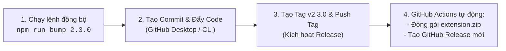

# 🚀 QUY TRÌNH PHÁT HÀNH BẢN CẬP NHẬT (DÀNH CHO ADMIN)

> **Dự án**: XMusicStation Auto Playlist & Queue Manager  
> **Repository**: [https://github.com/hotrocvst-cell/xmusic-station](https://github.com/hotrocvst-cell/xmusic-station)  
> **Nhánh mặc định**: `main`  
> **Cơ chế phát hành**: Tự động hóa 100% bằng GitHub Actions khi có **Tag phiên bản (`v*`)** được đẩy lên GitHub.

---

## 🎯 Tổng Quan Quy Trình

Mỗi khi Admin muốn bổ sung bài hát mới hoặc cập nhật tính năng:



---

## 🛠️ BƯỚC 1: ĐỒNG BỘ CẤU HÌNH DỰ ÁN (TỰ ĐỘNG BẰNG 1 LỆNH)

Dự án đã tích hợp sẵn công cụ tự động đồng bộ toàn bộ file cấu hình (`version.json`, `package.json`, `extension/manifest.json`, Userscript, Tampermonkey Guide).

Admin chỉ cần mở Terminal / PowerShell tại thư mục dự án và gõ:

```bash
# Cú pháp: npm run bump <phiên_bản_mới> [ghi_chú_cập_nhật]
npm run bump 2.3.0 "Bổ sung 50 bài hát hot V-Pop và tối ưu tốc độ nạp queue"
```

> [!TIP]
> **Tool sẽ tự động thực hiện 4 việc trong 1 giây:**
> 1. Cập nhật số phiên bản và ngày trong [`version.json`](version.json).
> 2. Cập nhật phiên bản trong [`package.json`](package.json).
> 3. Cập nhật phiên bản trong [`extension/manifest.json`](extension/manifest.json).
> 4. Tự động build lại [`userscript/xmusic-auto-playlist.user.js`](userscript/xmusic-auto-playlist.user.js) và trang [`tampermonkey-guide.html`](tampermonkey-guide.html).

---

## 🖥️ BƯỚC 2: PHÁT HÀNH BẰNG GITHUB DESKTOP (KHUYÊN DÙNG)

Nếu bạn thường xuyên sử dụng ứng dụng **GitHub Desktop**, hãy làm theo các bước trực quan dưới đây:

### 1. Kiểm tra và Tạo Commit
1. Mở ứng dụng **GitHub Desktop**.
2. Đảm bảo góc trên bên trái đang chọn đúng Repository: **`xmusic-station`** và Current branch: **`main`**.
3. Ở cột bên trái (tab **Changes**), bạn sẽ thấy các file vừa được cập nhật (`version.json`, `package.json`, `manifest.json`, `userscript/...`).
4. Nhìn xuống góc dưới bên trái:
   - Ô **Summary (bắt buộc)**: Nhập thông điệp, ví dụ:  
     `release: v2.3.0`
   - Ô **Description (tùy chọn)**: Nhập tóm tắt những bài hát hoặc tính năng mới cập nhật.
5. Bấm nút màu xanh: **`Commit to main`**.

---

### 2. Đẩy Commit lên GitHub
- Nhìn lên thanh công cụ trên cùng của GitHub Desktop:
- Bấm nút **`Push origin`** để đẩy code lên nhánh `main`.

---

### 3. Tạo và Đẩy Tag Phiên Bản (BƯỚC QUAN TRỌNG NHẤT)
> [!IMPORTANT]
> GitHub Actions chỉ tự động kích hoạt tạo Release khi phát hiện có **Tag phiên bản dạng `v*`** (ví dụ `v2.3.0`). Hãy tạo Tag ngay trong GitHub Desktop như sau:

1. Chuyển từ tab **Changes** sang tab **History** (nằm ngay phía trên cột bên trái).
2. Bạn sẽ thấy danh sách các commit, commit trên cùng chính là commit `release: v2.3.0` bạn vừa tạo.
3. **Bấm chuột phải (Right-click)** vào dòng commit đó -> Chọn **`Create Tag...`**.
4. Hộp thoại hiện ra:
   - Nhập tên Tag: **`v2.3.0`** *(lưu ý: phải có chữ `v` ở đầu)*.
   - Bấm nút **`Create Tag`**.
5. Sau khi tạo Tag, nhìn lên thanh công cụ phía trên:
   - GitHub Desktop sẽ xuất hiện nút **`Push origin`** (kèm thông báo có 1 tag cần đẩy).
   - Bấm nút **`Push origin`** để đẩy Tag lên kho GitHub!

---

### 4. Kiểm tra Thành Quả
Ngay sau khi bạn bấm Push Tag:
1. Mở trình duyệt vào kho GitHub: [https://github.com/hotrocvst-cell/xmusic-station/actions](https://github.com/hotrocvst-cell/xmusic-station/actions)
2. Bạn sẽ thấy quy trình **Auto Release on Important Update** đang chạy tự động:
   - Tự đóng gói `xmusic-station-extension.zip`.
   - Tạo bài viết Release tại [https://github.com/hotrocvst-cell/xmusic-station/releases](https://github.com/hotrocvst-cell/xmusic-station/releases).
   - Đính kèm đầy đủ file `.zip`, `.user.js` và `sample-playlists.json`.
3. Toàn bộ người dùng đang dùng extension khi mở tab **`🚀 Cập Nhật`** trên Web Player sẽ thấy thông báo có bản mới v2.3.0 và nạp được ngay!

---

## ⌨️ BƯỚC 2 (DỰ PHÒNG): PHÁT HÀNH BẰNG DÒNG LỆNH (GIT CLI)

Nếu bạn muốn thao tác nhanh bằng Terminal hoặc PowerShell thay vì GitHub Desktop:

```bash
# 1. Sau khi chạy npm run bump 2.3.0
git add .
git commit -m "release: v2.3.0"

# 2. Tạo tag phiên bản
git tag v2.3.0

# 3. Đẩy code và tag lên GitHub
git push origin main --tags
```

---

## 📋 BẢNG DANH MỤC CÁC FILE CẤU HÌNH LIÊN QUAN

Khi cấu hình dự án, các file sau đây nắm giữ các thông tin cốt lõi:

| File | Vai trò | Cách quản lý |
|---|---|---|
| [`version.json`](version.json) | File nguồn chứa phiên bản, ngày cập nhật, danh mục download và Release Notes | Tự động qua `npm run bump` |
| [`package.json`](package.json) | Cấu hình Node.js package & script lệnh | Tự động qua `npm run bump` |
| [`extension/manifest.json`](extension/manifest.json) | Khai báo quyền, phiên bản cho Chrome/Edge Extension | Tự động qua `npm run bump` |
| [`userscript/xmusic-auto-playlist.user.js`](userscript/xmusic-auto-playlist.user.js) | File script cài đặt trên Tampermonkey | Tự động build qua `build-userscript.js` |
| [`sample-playlists.json`](sample-playlists.json) | Kho 450 bài hát tuyển chọn chuẩn XMusic | Cập nhật khi bổ sung bài hát |
| [`.github/workflows/release.yml`](.github/workflows/release.yml) | Kịch bản tự động hóa GitHub Actions | Khởi chạy tự động khi push tag `v*` |

